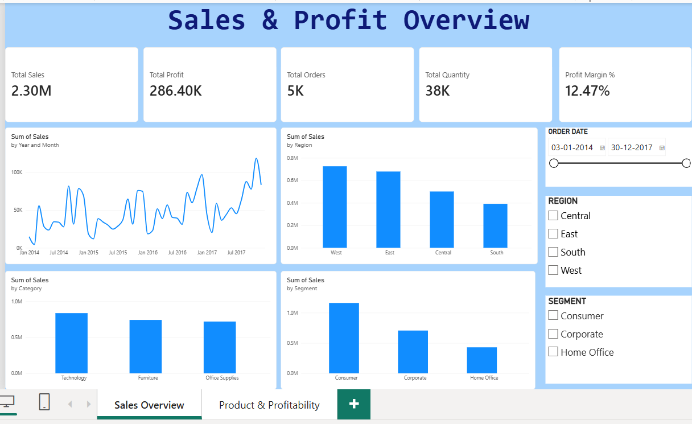
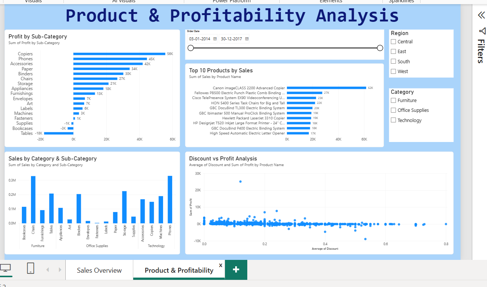

# Retail Sales & Profit Analysis Dashboard

## Project Overview
An interactive two-page Power BI dashboard developed to analyse retail sales performance, profitability, product categories and regional trends.

The project uses the Sample Superstore dataset to identify sales patterns, evaluate product performance and explore factors affecting profitability.

## Tools & Technologies
- Microsoft Power BI
- Power Query – Data Cleaning and Transformation
- DAX – Measures and Calculations
- Data Visualization

## Dashboard Pages

### 1. Sales & Profit Overview
- Total Sales, Total Profit, Total Orders, Total Quantity and Profit Margin KPIs
- Monthly Sales Trend
- Sales by Category
- Sales by Region
- Sales by Customer Segment

### 2. Product & Profitability Analysis
- Profit by Sub-Category
- Top 10 Products by Sales
- Discount vs Profit Analysis
- Sales by Category and Sub-Category
- Interactive Region, Category and Order Date slicers

## Key Measures
- Total Sales
- Total Profit
- Total Orders
- Total Quantity
- Profit Margin %

## Dataset
**Source:** [Sample Superstore Dataset – Kaggle](https://www.kaggle.com/datasets/vivek468/superstore-dataset-final)

The dataset contains retail transaction records, including sales, profit, product details, customer segments, regions and order dates.

## Dashboard Screenshots

### Sales & Profit Overview

### Product & Profitability Analysis

## Project Objective
The objective of this project is to transform raw retail data into meaningful business insights through data cleaning, DAX calculations and interactive visualisations.
